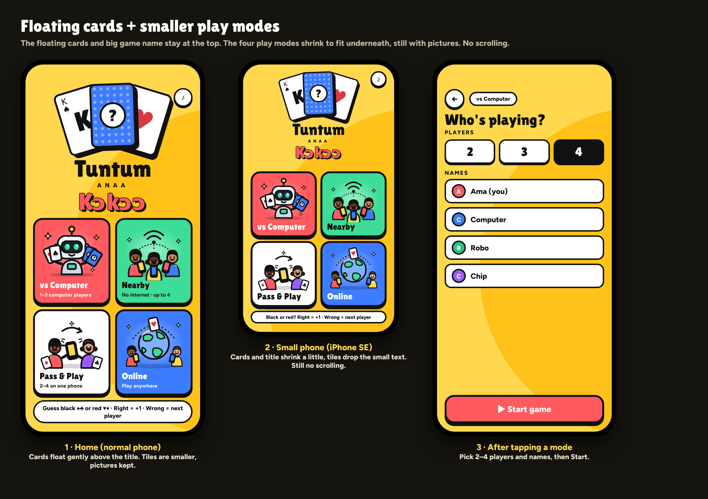
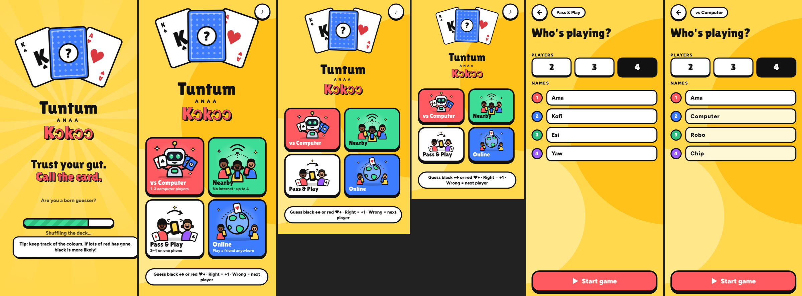

# Design decisions

## Home screen (approved 20 Oct 2026)

- No scrolling on any phone, including iPhone SE.
- Top: the floating fanned cards (K♠, blue "?" card that bobs, A♥) and the big stacked name **Tuntum / ANAA / Kɔkɔɔ**.
- Below: four smaller tiles in a 2×2 grid, each with an illustrated scene:
  vs Computer (red, robot dealer) · Nearby (green, friends on one hotspot) · Pass & Play (white, phone handed over) · Online (blue, globe).
- One-line rules strip at the bottom. Mute button top right.
- Small phones: cards and title scale down, tiles drop their small description.
- Tapping a tile opens **Who's playing?**: pick 2/3/4 players, edit names (remembered), Start game.

## Loading screen (approved 20 Oct 2026)
- Slogan: **"Trust your gut. Call the card."** with "Are you a born guesser?" underneath.
- Floating cards and game name, slowly turning light rays, a green loading bar ("Shuffling the deck…"), and a random tip at the bottom.

